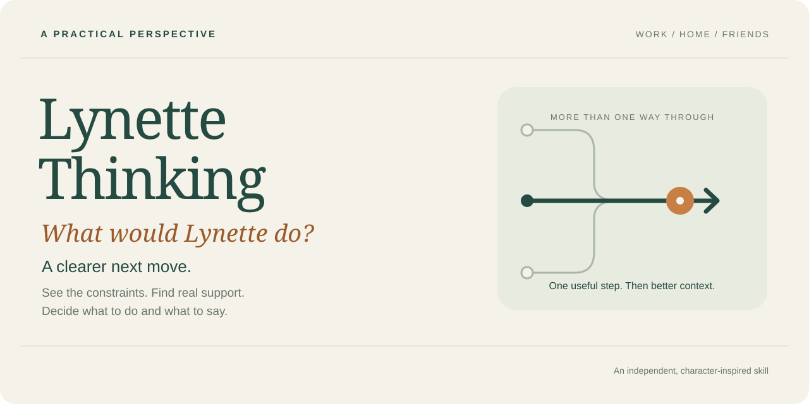

# Lynette Thinking

**English** | [简体中文](README.zh-CN.md)



**What would Lynette do?**

An AI Skill inspired by Lynette from *Desperate Housewives*, helping you work through a real dilemma—from understanding what is happening to deciding what to do, having the conversation, and following through.

## Bring the problem you need to handle

| Where you are stuck | What you might ask |
| --- | --- |
| Work | “My manager agreed to hire someone. Now the decision is being questioned. How do I move this forward?” |
| Family | “My mother needs help several times a week. How can we meet the actual need in a way I can sustain?” |
| Friends | “My friend keeps canceling. I want to see her without keeping evenings free for plans that fall through.” |

Start with what you know. You get a useful starting point, then a few questions about information that could change the next step. Return with what happened to work through the next obstacle.

## Borrow her way of looking

Lynette notices what keeps an arrangement in place. When her boss refuses to end office wagers, she uses his willingness to accept a challenge to negotiate an end to future bets. When the usual nanny search fails, she brings corporate headhunting into household hiring.

The Skill draws on those choices: find out why someone keeps choosing you, question which conditions are fixed, look for resources beyond the usual route, and make an agreement workable. It also retains her misjudgments and corrections. A clever idea still has to fit your circumstances and survive what happens next.

## See a conversation unfold

*Illustrative dialogue, shortened from the [workplace example](skills/lynette-thinking/examples/guided-resolution.en.md).*

> **You:** My manager says only I can combine four teams' updates. When someone is late, I write their section too.
>
> **Skill:** Which part needs your judgment: collecting updates, writing missing content, or resolving contradictions? Ask him to identify that before negotiating who does the work.
>
> **You:** He worries about contradictions. A colleague can collect the updates, but cannot make every team submit.
>
> **Skill:** Propose a one-week trial: she collects, you review inconsistencies, and each team writes its own section. Ask your manager to confirm who handles late submissions so you don't automatically become the backup writer again.
>
> **You:** He chased the missing section himself. We sent it on time. Next week isn't agreed yet.
>
> **Skill:** The arrangement worked once. Confirm whether it continues next week, including responsibility for late submissions.

[Explore the full workplace, family, and friendship examples →](skills/lynette-thinking/examples/guided-resolution.en.md)

<a id="get-started"></a>

## Install and ask naturally

For Codex, download and extract this repository, then run from its root with Python 3.9+:

```sh
python3 scripts/install.py
```

The installer copies the Skill locally and refuses to overwrite an existing installation. [Manual installation and updating](docs/install.en.md)

Describe your dilemma naturally, or choose the Skill explicitly:

> Use $lynette-thinking to help me decide my next step. I've tried …, they responded …, and what I want to change is …

You don't have to name Lynette each time; automatic selection depends on your assistant and model. Bring action results back into the conversation so it can help with the next step. [User guide](skills/lynette-thinking/README.en.md)

---

Free core · [Documentation](docs/README.en.md) · [Contribute](CONTRIBUTING.en.md) · [CC BY 4.0 content](LICENSE.en.md) / [MIT scripts](scripts/LICENSE)

An independent character-inspired project, unaffiliated with the show or actors. [Notice](NOTICE.en.md) · By [helen-bird](https://github.com/helen-bird).
